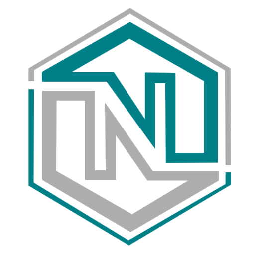

<p align="center">
  
</p>

<h1 align="center">NosCore.Analyzers</h1>

<p align="center">
  <a href="https://www.nuget.org/packages/NosCore.Analyzers/"></a>
  <a href="https://github.com/NosCoreIO/NosCore.Analyzers/actions/workflows/dotnet.yml"></a>
  <a href="https://discord.gg/Eu3ETSw"></a>
  <a href="LICENSE"></a>
</p>

Roslyn analyzers and diagnostic suppressors that every NosCore repository builds with. They report breaks of the
project's conventions, and silence nullable warnings where the framework fills the value.

## Install

```bash
dotnet add package NosCore.Analyzers
```

`NosCoreAnalyzers` is an error. The other rules are warnings, so they fail the build only with
`TreatWarningsAsErrors` (which NosCore turns on) or a `WarningsAsErrors` entry that names them.

`NosCoreLogArguments` checks the messages read through an `ILogLanguageLocalizer<T>` indexer. It reads their text from
the neutral `.resx` files the project passes as `AdditionalFiles`; without them the rule does not run:

```xml
<ItemGroup>
  <AdditionalFiles Include="Resource/*.resx" />
</ItemGroup>
```

## Rules

| Id | What it reports |
|---|---|
| `NosCoreAnalyzers` | An i18n packet whose arguments do not match what its message expects |
| `NosCoreLogArguments` | A log message given a different number of arguments than its text has placeholders |
| `NosCoreDateTimeNow` | Reading the system clock directly instead of through an injected NodaTime `IClock` |
| `NosCoreNullForgiving` | The null-forgiving operator `!` |

## Suppressors

| Suppresses | When |
|---|---|
| `CS8602`, `CS8604`, `CS8629` | Inside an Entity Framework query lambda, which is translated to SQL rather than run |
| `CS8618` | A required navigation on an Entity Framework entity; it is still null unless the query loads the related data |
| `CS8618` | A member of an MSTest class that one of the class's methods assigns |

## Building

```bash
dotnet build
dotnet test
```

## Contributing

Questions, ideas and pull requests are welcome; most of the discussion happens on [Discord](https://discord.gg/Eu3ETSw).
Any editor that handles .NET 11 works: `dotnet build` and `dotnet test` run on Windows, Linux and macOS.
In Visual Studio, [Roslynator](https://github.com/dotnet/roslynator) and
[ReSharper](https://www.jetbrains.com/resharper/) help keep to the code style.

## Supporting NosCore

NosCore is a spare-time open source project. Sponsoring buys time spent on the emulator and the packages around it,
and gives the **Supporter** role on Discord.

<p>
  <a href="https://github.com/sponsors/0Lucifer0"></a>
  <a href="https://ko-fi.com/A3562BQV"></a>
  <a href="https://www.patreon.com/bePatron?u=6503887"></a>
</p>

Thanks to [Navicat](https://www.navicat.com) for supporting the project.

<a href="https://www.navicat.com"></a>

## Legal

NosCore is an independent, unofficial project for educational use. It is not affiliated with, authorized, maintained,
sponsored or endorsed by Gameforge or any of its affiliates; NosTale is a trademark of Gameforge. Using it may be
against the terms of service of NosTale servers.

Released under the [MIT License](LICENSE).
